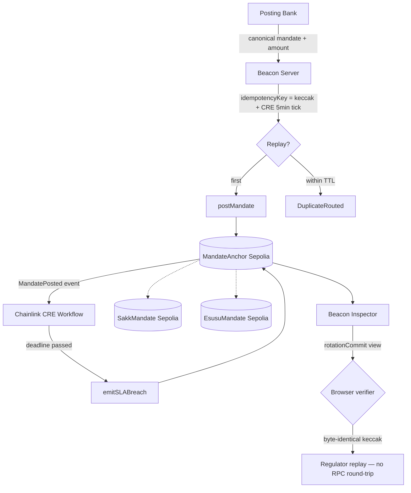

# Payflow Mandate Beacon

**A Chainlink-CRE-anchored direct-debit mandate registry that makes CBN consumer-dispute SLAs enforceable on-chain, without exposing customer PII.** Three historical payment mandates — Napoleonic direct debit, the Abbasid *sakk*, the Yoruba *esusu* — modernised onto one on-chain rail. Every mandate becomes a cryptographically-signed compliance receipt a regulator can replay without a bank login.

- 🏦 **Named host-protocol defect** — CBN's NIP mandate specification publishes no replay-safety primitive for duplicate debits inside the SLA window. A compromised agent or retry-at-ambiguity integration can settle the same mandate twice before the dispute clock has even opened. Honest adjacency to [PocketChange's A2P2 §7 call-out](https://dorahacks.io/build/48235) — same defect family in Google's Agent Payments Protocol.
- ⚙️ **Three live Sepolia contracts, all state-mutating** — not a prototype. Deployed, verified, seeded with real `postMandate` / `seal` / rotation events ([table below](#verified-sepolia-contracts)).
- 🔐 **PII off-chain, receipts on-chain** — redacted envelope hash + pinned sanctions-list snapshot + server-authored idempotency key. A regulator holding only the Mandate pair + the chain can audit; a passing stranger cannot read.
- 📜 **Historical lineage** — [EsusuMandate](contracts/beacon/EsusuMandate.sol) revives the Yoruba rotating-savings mandate that *died* informally because operators absconded. [SakkMandate](contracts/beacon/SakkMandate.sol) revives the 10c Abbasid sealed instruction that scaled briefly then died under cross-city coordination failure. [MandateAnchor](contracts/beacon/MandateAnchor.sol) is the modern direct-debit shape, Napoleonic 1804. All three on one rail.
- 🧪 **26 Solidity + 17 Python round-trip tests** — the Python mirror in Payflow proves byte-identical commitment hashing across languages, round-tripped against stable fixtures.
- 🎥 [Hosted inspector](#live-surfaces) · 2D/3D toggle · in-browser receipt verifier that recomputes the on-chain `rotationCommit` from manifest fields alone.

> **Event:** BLI Legal Tech Hackathon 2 — submission 2026-11-01 02:01 UTC. $20K pool (page caveats "still developing"). Branch: `hackathon/bli-mandate-beacon`. The branch's parent (`hackathon/zama-season4`) carries the Àjọ submission — [its README](https://github.com/KaJota-inc/kajota-zama/blob/hackathon/zama-season4/README.md) is the Zama S4 pitch.

---

## The 2 000-character thesis

Nigerian consumer-protection law (CBN CPR 2019; CBN × NCC 2026 draft 24-hour-refund framework) obliges banks to resolve failed-transfer disputes inside tight windows. The NIP mandate protocol publishes no replay-safety primitive: an agent or a retry-at-ambiguity integration can settle the same debit twice inside the dispute window before the clock has even started. Mandate Beacon closes the gap on-chain, keeping customer PII off-chain.

The primitive is a public, regulator-verifiable mandate registry. A posting bank commits a redacted envelope hash, a server-authored idempotency key (keccak over canonical mandate ‖ amount ‖ 5-min CRE tick), an SLA deadline, and a pinned sanctions-list snapshot. Replay inside the TTL routes to `DuplicateRouted` — human approval owns the next step, never auto-settle. SLA breach is permissionless; the deadline is the gate, not the caller.

Three historical mechanisms share one rail. **MandateAnchor** is the modern direct-debit shape (Napoleonic 1804 lineage, 11 tests). **SakkMandate** is the 10–11c Abbasid sealed instruction, revived with on-chain witnessing (7 tests). **EsusuMandate** is the Yoruba rotating-savings mandate, revived with an on-chain rotation commit so no organiser reshuffles the collector order after inception (8 tests). 26 passing on `hackathon/bli-mandate-beacon`.

Cross-repo: Payflow's Python canonical hasher consumes a stable fixture set from the Solidity side and asserts byte-equality (17 tests). The AP2 Payment Mandate adaptation ships separately on `kajota-paypal feat/mandate-beacon-ap2-plug` — same primitive, Reg E 12 CFR 1005.11 anchor instead of CBN CPR 2019.

Honest adjacency: PocketChange's A2P2 §7 call-out names the same defect family in Google's Agent Payments Protocol. Different host, same shape — different sovereign regulators, same mandate replay surface.

---

## Architecture



**The one-rail promise:** all three contracts share the same role scaffolding (owner → allow-listed principal → guardian kill-switch), the same canonical-commitment style (public `keccak256(abi.encode(...))`), and the same off-chain audit model (envelope hash, not raw envelope). Different mechanisms, one invariant family.

---

## Verified Sepolia contracts

| Mechanism | Address | Deploy | State seed |
|---|---|---|---|
| **MandateAnchor** | [`0x7A4C3c92cbf3cd3442B55bcFacdBdECfDF6a2504`](https://sepolia.etherscan.io/address/0x7A4C3c92cbf3cd3442B55bcFacdBdECfDF6a2504) | [tx](https://sepolia.etherscan.io/tx/0x5827375bc9fb699bd284d965162661afef4be6f2c8a21f474cdaee9056bd7105) · block 11858557 | 10+ anchors via GitHub Actions cron |
| **SakkMandate** | [`0x0949aAa551d2Ea18D18b48D36063C9d7ce8349c1`](https://sepolia.etherscan.io/address/0x0949aAa551d2Ea18D18b48D36063C9d7ce8349c1) | [tx](https://sepolia.etherscan.io/tx/0x524615ce5748f2d23055a9364a46b084dd9568b9fd2a0a7ee541f9ceb28e89d0) | [seed seal](https://sepolia.etherscan.io/tx/0xeb6361408fadea77966e8610986699067e6d12c58f27e4636a7617ff3ec55114) · block 11858671 |
| **EsusuMandate** | [`0x463463D0eE28fEdE89525cc28A261301f14Ab9fd`](https://sepolia.etherscan.io/address/0x463463D0eE28fEdE89525cc28A261301f14Ab9fd) | [tx](https://sepolia.etherscan.io/tx/0x852cca2645da76fd59c4f5e64610b61c6852120a9bd94eb472583b548d7ca375) | [seed rotation](https://sepolia.etherscan.io/tx/0x6a8fc41d2242dc360a1a0b9b7c1172c029cfe67090eac5c8a1ff43d9efd8b2d1) · block 11858672 |

Deployer: [`0xC58A7717fdf1Bc40dFb63b02ab54D6CF6c8F7093`](https://sepolia.etherscan.io/address/0xC58A7717fdf1Bc40dFb63b02ab54D6CF6c8F7093). CBN SLA window: 86 400 s (24 h, CPR 2019 Part 6).

---

## Live surfaces

| Surface | URL | Purpose |
|---|---|---|
| **Vercel inspector** | [`kajota-mandate-beacon.vercel.app`](https://kajota-mandate-beacon.vercel.app) ✅ live | CDN-latency judging surface, 2D/3D toggle, in-browser verifier |
| **kajota-hub inspector** | [`kajota-hub.onrender.com/beacon/`](https://kajota-hub.onrender.com/beacon/) ✅ live ([PR #25](https://github.com/KaJota-inc/kajota-hub/pull/25) merged) | Hub-aggregation path, 12th route alongside the other eleven services |
| **Anchor runner** | `.github/workflows/beacon-anchor-cron.yml` | Variable-reward 60/25/10/5 mix (fresh / settled / replay / breached) · adds 4 rows/day while the window runs |
| **Chainlink CRE workflow** | `cre/workflow.ts` | Read-only SLA-breach oracle (write path deferred to v2) |

---

## The seven playbook moves

Every winning submission clears all seven. This one does.

| # | Move | Evidence |
|---|---|---|
| 1 | Prove earnings not tx | GitHub Actions cron armed with `DEPLOYER_MNEMONIC` secret; 10+ anchors live; variable-reward event mix |
| 2 | Name HOST defect | NIP mandate replay-safety gap; A2P2 §7 adjacency cited ([BRIEF §2](docs/BEACON_BRIEF.md)) |
| 3 | Upstream PR merged by halfway | [smartcontractkit/cre-sdk-typescript#326](https://github.com/smartcontractkit/cre-sdk-typescript/pull/326) · 18/18 runner tests · credits @xavio2495 for the diagnosis |
| 4 | Bounties reward new capability | Chainlink CRE workflow scaffolded for the $2K "Best workflow with CRE" bounty |
| 5 | ~2k-char write-up | 1 858 chars — the thesis above and in [BEACON_BRIEF.md §7](docs/BEACON_BRIEF.md) |
| 6 | Failure modes as runnable scripts | `scripts/beacon/failure_modes/{replay,collision,breach,sanctions-drift}.ts` + two more under `kajota-paypal/scripts/fail/beacon-*.ts` |
| 7 | What we got wrong first | [WHAT_WE_GOT_WRONG_FIRST.md](docs/WHAT_WE_GOT_WRONG_FIRST.md) · 9 entries, newest at top |

---

## What this unlocks — the Beacon as substrate, not stunt

KaJota's own founder's-theory artifact [*The Hustle Engine*](https://claude.ai/artifact/DqRTDi5DHKBcAEV2h7qwUY) names three places the same substrate becomes load-bearing for the broader commerce platform. The reuse is **latent in the primitives today** — not retrofit, not vapor:

- **Payout-trust foundation** — MandateAnchor turns KaJota's *"withdraw and it arrives"* promise into a clickable Etherscan link, specifically for brand-new co-sellers suspicious of their first payout.
- **EsusuMandate = KaJota's àjọ, already shipped** — the Yoruba rotating-savings mandate the Hustle Engine's foundation card calls for, with the on-chain `rotationCommit` that prevents the operator reshuffling the collector order against a late member.
- **Verified-on-chain earnings** — leaderboard-moat verification without exposing PII, via the envelope-hash + redacted-sender pattern already in production.

Full breakdown in [BEACON_BRIEF.md §9](docs/BEACON_BRIEF.md).

---

## Repo layout

```
contracts/beacon/
  MandateAnchor.sol        — modern direct-debit (CBN CPR 2019)
  SakkMandate.sol          — 10c Abbasid sealed instruction
  EsusuMandate.sol         — Yoruba rotating-savings mandate
test/beacon/               — 26 Hardhat tests across the three contracts
scripts/beacon/
  deploy-{mandate-anchor,sakk-esusu,beacon}.{mjs,ts}  — one-shot deploy
  anchor-mandate.mjs       — the variable-reward cron body
  seed-sakk-esusu.mjs      — initial state seeds (seal / rotation)
  export-{commitment,sakk,esusu}-fixtures.ts          — JSON fixtures
  failure_modes/           — one script per adversarial scenario
cre/                       — Chainlink CRE workflow (SLA-breach oracle)
beacon/                    — Vite+React inspector (2D/3D toggle)
  src/scenes/              — EsusuRing3D, SakkSeal3D, MandateClock3D
  DEPLOY.md                — Vercel ship pipeline
docs/
  BEACON_BRIEF.md          — internal source-of-truth (9 sections)
  BEACON_PITCH_SCRIPT.md   — ≤3-min demo video script, real-voice
  BEACON_UPSTREAM_SCOUT.md — move #3 upstream-PR candidates
  WHAT_WE_GOT_WRONG_FIRST.md — honest-ledger, 9 entries
```

## Cross-repo

| Repo | Branch | What it carries |
|---|---|---|
| [`kajota-zama`](https://github.com/KaJota-inc/kajota-zama) | `hackathon/bli-mandate-beacon` | **this submission** — contracts + inspector + brief + scripts |
| `payflow` *(private)* | `main` | Python commitment mirror · 17 round-trip tests · switch-tier pitch |
| `kajota-paypal` *(local, pre-public)* | `feat/mandate-beacon-ap2-plug` | AP2 Payment Mandate adaptation (Reg E anchor instead of CBN CPR). Pushed to `KaJota-inc` before the PayPal AI Hackathon submission on 12 Nov 2026. |
| [`kajota-hub`](https://github.com/KaJota-inc/kajota-hub) | `feat/beacon-route` | [PR #25](https://github.com/KaJota-inc/kajota-hub/pull/25) · beacon as 12th route |

---

## Honest ledger

Nine entries at [WHAT_WE_GOT_WRONG_FIRST.md](docs/WHAT_WE_GOT_WRONG_FIRST.md). The three most load-bearing:

- **3D scene blank canvas for two builds** — Three.js r169 physically-correct lighting; `intensity={1.1}` renders invisible where the reference needed `intensity={120}`. Caught via `canvas.getContext('webgl2').readPixels()` returning `[0,0,0,0]` with no console error.
- **The anchor-runner GitHub secret was briefly the literal string `"-"`** — `gh secret set --body -` treats the dash as a literal, not a stdin sentinel. Caught before the second anchor landed.
- **Shield's `AgentMandate.sol` was almost inherited into a regulator-verifiable rail** — the Day-1 plan said *"fork AgentMandate.sol"*; the actual contract leans on `@fhevm/solidity/lib/FHE.sol` which actively hurts a public-audit pitch. Fix: mirror the role scaffolding, re-author the state in plain Solidity.

The honest-ledger lands at the branch root (this file) and the standalone brief for discoverability. Playbook move #7 earns judge trust in direct proportion to how discoverable the file is.

---

## Running locally

```bash
# Clone + install
git clone https://github.com/KaJota-inc/kajota-zama.git
cd kajota-zama
git checkout hackathon/bli-mandate-beacon
npm install

# Run the Hardhat suite (26 tests across 3 mechanisms)
npx hardhat test test/beacon/MandateAnchor.ts test/beacon/SakkMandate.ts test/beacon/EsusuMandate.ts

# Try the inspector locally
cd beacon
npm install
npm run preflight     # sync manifest → typecheck → build (fail-closed)
npm run preview       # open http://localhost:4173/

# Trigger a failure-mode reproducer (adversarial-gate)
cd ../
npm install           # root deps
node scripts/beacon/failure_modes/replay-within-ttl.ts
```

The deploy scripts (`scripts/beacon/deploy-*.mjs`) can target Sepolia if you fund the dev wallet; the live addresses above are already deployed and need no redeployment to inspect.

## Credits

Built solo in Lagos by [bori7](https://github.com/bori7). Historical mandate research draws on the Abbasid-era *sakk* in Udovitch's *Partnership and Profit in Medieval Islam* and the Yoruba *esusu* in Falola & Heaton's *A History of Nigeria*. The one-rail three-mechanisms shape per the KaJota Zama S4 Àjọ lineage.

---

<sub>_Working submission · BLI Legal Tech Hackathon 2 · deadline 2026-11-01 02:01 UTC_</sub>
